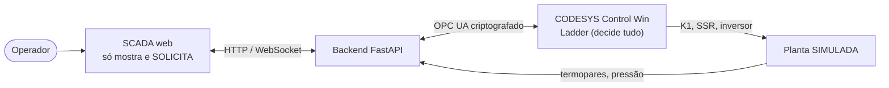

# LFAM Automation

**Supervisão e controle de uma extrusora de impressão 3D de grande formato (LFAM)**: programa **Ladder real** executado num CLP virtual (CODESYS Control Win), tela de operação web (SCADA) e uma planta simulada para testar tudo sem máquina física.
Projeto acadêmico de Automação Industrial — **não é segurança certificada nem controla máquina real**.

<p align="center">
  <br>
  <sub>SCADA em modo <b>DEMO / SIMULADO</b>: ligar aquecimento → encharque → pronto → extrusão → falha de pressão travada → reset (relógio acelerado).</sub>
</p>

## O que é, em 30 segundos
- Um **programa Ladder** (15 redes, 6 PIDs `Util.PID`, temporizadores, falhas travadas) decide tudo: aquece 5 zonas, espera 15 min de encharque, libera a extrusão e protege contra falhas.
- Ele roda no **CODESYS Control Win** (CLP virtual). Veja as redes em [docs/LADDER.md](docs/LADDER.md).
- Uma **tela web** (React) mostra o processo e **só envia pedidos**; o sucesso aparece **depois** que o CLP confirma.
- Entre os dois há um **backend FastAPI** que fala com o CLP por **OPC UA criptografado**.
- Como não existe a máquina, uma **planta simulada** devolve temperaturas, pressão e falhas.



**Leia primeiro:** [docs/COMO_FUNCIONA.md](docs/COMO_FUNCIONA.md) — explica passo a passo como o clique na tela vira uma variável no Ladder e volta, o que é real × simulado, glossário e perguntas de quem chega de fora.

## Telas (modo DEMO)
<p align="center">
  
  <br>
  
  
</p>
<p align="center"><br><sub>Mesmo fluxo no celular — a interface é responsiva (1920 → 390 px).</sub></p>

## O que foi **provado** (e o que não foi)
| Item | Estado | Evidência |
|---|---|---|
| Ladder gráfico gerado, importado e **compilado** no CODESYS (110 elementos) | Comprovado (0 erros, 0 avisos) | [CP4](docs/evidence/CP4_NETWORKS_STATUS.md) |
| Ladder **executa** no Control Win | Comprovado | [CP2](docs/evidence/CP2_online_run2.log), [CP3](docs/evidence/CP3_ROUNDTRIP_OK.txt) |
| Tela → API → **OPC UA** → Ladder → tela (ida e volta) | Comprovado | [CP3](docs/evidence/CP3_ROUNDTRIP_OK.txt) |
| Cenários no CLP: falhas, reset condicionado, encharque de 15 min, pressão | Comprovado em tempo real | [CP4 online](docs/evidence/CP4_ONLINE_SCENARIOS.txt) |
| SCADA de 6 telas, 4 tamanhos, E2E | Comprovado em DEMO | [`docs/evidence/scada`](docs/evidence/scada) |
| Sintonia dos PIDs, escala do inversor, parâmetros da planta | **Hipóteses** (não calibrados) | [relatório](docs/IMPLEMENTATION_REPORT.md) |
| Máquina física, PROFINET, Siemens S7-1200 | **Não testado** (proposta acadêmica) | [reconciliação](docs/SOURCE_RECONCILIATION.md) |

O ensaio no CLP real **achou defeitos que os testes em Python não viam** (temporizadores zerados na importação; falso alarme de sobretemperatura com termopar aberto). Foram corrigidos e ganharam teste de regressão — ver [relatório](docs/IMPLEMENTATION_REPORT.md).

## Como abrir (três níveis)
Guia completo: **[docs/INICIO_RAPIDO.md](docs/INICIO_RAPIDO.md)**.

**1. Ver a tela funcionando (qualquer PC com Python e Node, ~10 min, sem CODESYS):**
```powershell
git clone <URL> lfam-automation ; cd lfam-automation
powershell -ExecutionPolicy Bypass -File .\tools\setup.ps1          # instala tudo
powershell -ExecutionPolicy Bypass -File .\tools\start-demo.ps1     # sobe backend + tela e abre o navegador
```
**2. Testes:** `powershell -ExecutionPolicy Bypass -File .\tools\run-tests.ps1` (`-E2E` inclui a interface).
**3. Ladder de verdade no CODESYS:** [instalação](docs/INSTALLATION_COMPLETE.md) → [modo PLC](docs/CP3_PLC_MODE.md) → `tools\start-plc.ps1 -User SEU_USUARIO -Web` (a senha é pedida de forma oculta).
**Projeto CODESYS:** `codesys/LFAM_Automacao_Ladder.project` (o `LFAM_Automacao.project` da raiz é o original do grupo e não é alterado).

## Documentação
| Para quê | Documento |
|---|---|
| Entender o projeto do zero | [COMO_FUNCIONA](docs/COMO_FUNCIONA.md) |
| Usar em outro PC (passo a passo) | [INICIO_RAPIDO](docs/INICIO_RAPIDO.md) |
| Entender o Ladder (etapa por etapa) | [LADDER_EXPLICADO](docs/LADDER_EXPLICADO.md) · [imagens das 15 redes](docs/LADDER.md) |
| Como o backend fala com o CODESYS | [LIGACAO_BACKEND_CODESYS](docs/LIGACAO_BACKEND_CODESYS.md) |
| Arquitetura técnica | [ARCHITECTURE](docs/ARCHITECTURE.md) |
| Instalar e rodar | [INSTALLATION_COMPLETE](docs/INSTALLATION_COMPLETE.md) · [SCADA_RUN](docs/SCADA_RUN.md) · [CP3_PLC_MODE](docs/CP3_PLC_MODE.md) · [SETUP_WINDOWS](docs/SETUP_WINDOWS.md) · [MCP_TROUBLESHOOTING](docs/MCP_TROUBLESHOOTING.md) |
| O que foi feito e provado | [IMPLEMENTATION_REPORT](docs/IMPLEMENTATION_REPORT.md) · [evidence](docs/evidence) · [AUDIT](docs/AUDIT_TESTS_AND_GENERATOR.md) |
| Fontes, divergências e decisões | [SOURCE_RECONCILIATION](docs/SOURCE_RECONCILIATION.md) · [tags.csv](docs/tags.csv) |
| Trabalho acadêmico | [ACADEMIC_COMPLIANCE](docs/ACADEMIC_COMPLIANCE.md) · [ROTEIRO_APRESENTACAO](docs/ROTEIRO_APRESENTACAO.md) |

## Estrutura
`codesys/` gerador e XML do Ladder · `backend/` FastAPI e transportes (DEMO/OPC UA) · `scada/web/` interface React · `simulator/` planta · `tools/` scripts (gerar, compilar, ensaiar, gravar mídia) · `tests/` pytest · `docs/` guias e evidências.

Testes: `pytest -q tests` (85) e, em `scada/web`, `npx playwright test` (exige o backend DEMO).
Diagnóstico do ambiente Windows: `.\tools\diagnose-windows.ps1`.

## Segurança e escopo
Projeto **educacional / simulador**. HMI e software de controle comum **não substituem** parada de emergência (circuito de hardware independente), dispositivos de segurança certificados, análise de riscos nem comissionamento. Nunca escrever comandos em máquina física sem avaliação e autorização. Credenciais ficam **somente** em variáveis de ambiente da sessão; nada de segredos, licenças ou tickets no repositório.

## Contexto acadêmico
Trabalho multidisciplinar de Automação Industrial: monografia escrita à mão, apresentação oral de 20 minutos e arguição. A proposta usa Siemens S7-1200; a demonstração executável usa CODESYS Control Win — as diferenças estão em [SOURCE_RECONCILIATION](docs/SOURCE_RECONCILIATION.md). Materiais de terceiros e do grupo (`references/`) não são versionados; revise licenças antes de tornar o repositório público.
