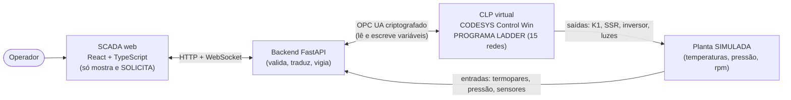

# Como o projeto funciona (explicado para quem chegou agora)

Este documento responde, em linguagem simples: **o que é, para que serve, como abrir, como a tela (SCADA) controla o Ladder e o que é real × simulado.** Se alguém de fora perguntar sobre o projeto, comece por aqui; as respostas rápidas estão na seção [Perguntas de quem chega de fora](#perguntas-de-quem-chega-de-fora).

## 1. Em uma frase
Uma **extrusora de impressão 3D de grande formato (LFAM)** é controlada por um **programa em Ladder** (a linguagem gráfica dos CLPs) que roda num **CLP virtual (CODESYS Control Win)**; uma **tela web (SCADA)** mostra o processo e envia *pedidos* ao CLP por um servidor intermediário; como não há máquina real, uma **planta simulada** faz o papel dos sensores e atuadores.

## 2. O problema
Uma extrusora LFAM aquece plástico em cinco zonas (~330 a 375 °C), mantém tudo quente por 15 minutos antes de começar ("encharque"), empurra o material com uma rosca de 17 a 34 rpm e vigia pressão (alarme em 16,5 MPa, parada em 17 MPa), ventilação do motor, falta de material e sensores rompidos. Tudo isso precisa de **sequência, intertravamentos e falhas que ficam travadas até alguém reconhecer** — trabalho típico de um CLP.

O trabalho acadêmico (Automação Industrial) propõe o projeto com um Siemens S7-1200. Para **provar que a lógica funciona** sem comprar hardware, ela foi implementada e executada em um CLP **virtual** (CODESYS Control Win). As diferenças entre o projeto proposto e o que foi executado estão em [SOURCE_RECONCILIATION.md](SOURCE_RECONCILIATION.md).

## 3. As peças



| Peça | O que faz | O que **não** faz |
|---|---|---|
| **Ladder no CLP** (`codesys/`) | **Decide tudo**: permissivos, sequência, PIDs, temporizadores, falhas travadas, reset condicionado | Não desenha a tela nem fala HTTP |
| **Backend FastAPI** (`backend/`) | Recebe pedidos da tela, valida faixas, escreve **só entradas permitidas** no CLP, lê o estado de volta, detecta perda de comunicação | **Não** decide a lógica de segurança |
| **SCADA web** (`scada/web/`) | Mostra estado, gráficos, alarmes, receitas; envia **solicitações** | **Não** muda o estado sozinho: só mostra "confirmado" depois que o CLP confirma |
| **Planta simulada** (`simulator/`) | Faz de conta que é a máquina: esquenta, pressuriza, falha quando mandamos | Não decide permissivos; parâmetros são **hipotéticos** |
| **Gerador** (`codesys/generator/`) | Escreve o Ladder em código (Python) e o converte para PLCopen XML, que o CODESYS importa | — |

## 4. Como a tela controla o Ladder (passo a passo)
Exemplo: o operador clica em **"Ligar aquecimento"**.

1. **Tela → API.** O navegador faz `POST /api/command {"name": "BT_AQUEC"}`. O botão passa a *"Aguardando CLP…"* (não muda de estado ainda).
2. **API valida.** O backend só aceita nomes da lista (`BT_AQUEC`, `BT_LIGA`, `STOP`, `BT_RESET`) e recusa tudo se o CLP estiver sem comunicação.
3. **API → CLP.** O comando vira um **pulso de 0,5 s** na variável de entrada `BT_AQUEC`, escrita por **OPC UA em canal criptografado** (`Basic256Sha256`, usuário e senha do dispositivo). O backend **só escreve entradas** (botões, setpoints, sensores) — nunca as saídas do programa.
4. **O Ladder decide.** A rede 05 liga `EST_AQUEC` **somente se** todos os permissivos estão certos: `SEG_OK`, `DISJ_AQUEC`, sem `FALHA_GERAL`, sem sobretemperatura e sem contator colado. Se qualquer um falhar, **nada acontece** — e a tela mostra que não foi confirmado.
5. **Saídas.** `EST_AQUEC` fecha o contator `K1_AQUEC`. As redes 06 rodam os **5 PIDs** (a cada 100 ms) e as portas liberam os **SSR** das resistências.
6. **Planta responde.** A planta simulada recebe `K1`/`SSR`, esquenta e devolve os sinais dos termopares como **entradas** do CLP.
7. **API lê de volta.** A cada ciclo o backend lê o estado real do CLP (incluindo o **heartbeat** `PLC_HEARTBEAT`, que o Ladder incrementa a cada ciclo).
8. **Tela mostra.** Só quando `K1_AQUEC` e o estado `AQUECIMENTO` voltam do CLP, o botão vira **"✓ Confirmado"** e o sinótico acende. Se o heartbeat parar por mais de 2 s, a tela mostra **SEM COMUNICAÇÃO**, desabilita comandos e deixa de pintar valores em verde.

**Regras que protegem o sistema (e foram testadas):** o botão só *solicita*; o sucesso vem do CLP; comandos são descartados (nunca reenviados) quando o enlace cai; falha de segurança **trava** e só sai com `BT_RESET` **depois que a causa sumiu**; a emergência de verdade é um circuito de **hardware independente** — esta interface **não é** parada de emergência.

## 5. Dois modos: DEMO × PLC
O selo no canto da tela diz sempre em que modo você está.

| | **DEMO / SIMULADO** | **LÓGICA NO CLP · PLANTA SIMULADA** |
|---|---|---|
| Quem executa o Ladder | Um **avaliador em Python** (cópia fiel da mesma estrutura) | O **CODESYS Control Win** (o programa real compilado) |
| Precisa de CODESYS? | **Não** (abre em qualquer PC) | Sim (Windows, runtime iniciado) |
| Tempo | Pode ser acelerado (×30) para demonstrar rápido | Tempo **real** (encharque = 15 min de verdade) |
| Serve para | Ver e demonstrar a interface, treinar o fluxo | **Provar** que o Ladder real executa e responde |
| Planta | Simulada | **Continua simulada** (não há máquina) |

## 6. O que é real e o que é simulado
- **Real:** o Ladder (gráfico, importado e compilado no CODESYS), sua execução no Control Win, o canal OPC UA criptografado, os PIDs `Util.PID` da biblioteca oficial, os temporizadores e a lógica de falhas/reset.
- **Simulado:** a máquina inteira (temperaturas, pressão, rotação, sensores), a sintonia dos PIDs e a escala do inversor são **hipóteses didáticas**, não calibradas. **Nenhum resultado aqui autoriza comandar uma máquina real.**
- **Onde está provado:** [IMPLEMENTATION_REPORT.md](IMPLEMENTATION_REPORT.md) lista cada requisito com a evidência. Os ensaios no CLP estão em `docs/evidence/` (`CP3_ROUNDTRIP_OK.txt`, `CP4_ONLINE_SCENARIOS.txt`).

## 7. Como abrir (escolha o caminho)

**A. Só ver o SCADA funcionando (5 min, qualquer PC, sem CODESYS)** — modo DEMO:
```powershell
# na raiz do repositório
python -m venv .venv ; .\.venv\Scripts\pip install -r requirements-dev.txt
$env:LFAM_TIME_SCALE = "30"                       # acelera o relógio simulado
.\.venv\Scripts\python.exe -m uvicorn backend.app:app --port 8000
# em outro terminal:
cd scada\web ; npm install ; npm run dev          # abra http://localhost:5173
```
Passo a passo da demonstração: *Ligar aquecimento* → aguarde *PRONTO* → *Iniciar extrusão* → aba *Alarmes* para injetar uma falha de pressão → *Reset*.

**B. Ver o Ladder rodando de verdade (CLP virtual):** siga [INSTALLATION_COMPLETE.md](INSTALLATION_COMPLETE.md) (instalar CODESYS) e depois [CP3_PLC_MODE.md](CP3_PLC_MODE.md) (certificados, símbolos, backend em modo PLC). O script `tools/cp3_roundtrip.py` prova a ida e volta; `tools/cp4_scenarios.py` roda os cenários completos.

**C. Abrir o projeto CODESYS:** `codesys/LFAM_Automacao_Ladder.project` (Ladder completo + objetos OPC UA). O `LFAM_Automacao.project` da raiz é o projeto original do grupo e **não é alterado**. Para ver as 15 redes sem abrir o CODESYS: [LADDER.md](LADDER.md).

## 8. Mapa do repositório
```
codesys/generator/   gera o Ladder (DSL Python -> PLCopen XML) + avaliador de referência
codesys/exports/     LFAM_PROGRAM.xml (o que é importado no CODESYS)
backend/             FastAPI: transportes DEMO e OPC UA, motor, API e WebSocket
scada/web/           React + TypeScript (6 telas) e testes E2E (Playwright)
simulator/           planta física didática
tools/               scripts: gerar XML, compilar no CODESYS, ensaios, mídia, diagnóstico
tests/               pytest (Ladder, simulador, backend, OPC UA, segurança do avaliador)
docs/                guias, relatório, evidências (docs/evidence), catálogo do Ladder
references/          materiais do grupo (NÃO versionados)
```

## 9. Glossário
- **CLP/PLC:** computador industrial que executa a lógica de controle em ciclos rápidos (aqui, 100 ms).
- **Ladder (LD):** linguagem gráfica de CLP: contatos (condições) e bobinas (saídas) entre dois trilhos de energia.
- **CODESYS Control Win:** CLP **virtual** que roda no Windows.
- **PLCopen XML:** formato aberto de programa; é como o Ladder gerado entra no CODESYS.
- **OPC UA:** protocolo industrial para ler/escrever variáveis do CLP com autenticação e criptografia.
- **SCADA/HMI:** tela de supervisão e operação.
- **PID:** controle que ajusta a potência para levar a temperatura ao valor desejado (SP); **SSR:** relé de estado sólido que liga a resistência (aqui com PWM).
- **Encharque:** manter as 5 zonas ≥ 330 °C por 15 min contínuos antes de extrudar.
- **TON:** temporizador "liga-atraso". **Latch/selo:** a saída se mantém ligada até ser desligada de propósito (falha travada).
- **Heartbeat:** contador que o CLP incrementa a cada ciclo; se parar, a tela sabe que o dado está velho.
- **DEMO:** modo simulado sem CLP.

## Perguntas de quem chega de fora

**O que o projeto faz?** Controla (em simulação) uma extrusora de impressão 3D de grande formato: aquece, espera o encharque, extruda e protege contra falhas, com tela de operação web.

**É uma máquina real?** Não. A máquina é simulada. O **Ladder é real e executa** num CLP virtual; a planta é um modelo didático.

**Por que CODESYS e não o Siemens do trabalho?** O CODESYS Control Win é grátis para teste, roda no PC e executa Ladder real (IEC 61131-3). A proposta acadêmica continua S7-1200; as diferenças estão documentadas.

**O que a tela web pode fazer?** Ver estado, gráficos e alarmes; pedir aquecimento, extrusão, parada e reset; ajustar setpoints dentro de faixas. **Ela só pede**; quem decide é o Ladder.

**A tela é segura para parar a máquina?** **Não.** A parada de emergência é hardware independente. Isto é um projeto educacional.

**Como sei se estou vendo dados reais do CLP?** O selo no topo: `DEMO / SIMULADO` (sem CLP) ou `LÓGICA NO CLP · PLANTA SIMULADA`. Se o heartbeat para, aparece `SEM COMUNICAÇÃO` e os valores deixam de ser coloridos.

**O que foi testado de verdade?** Importação e compilação do Ladder (0 erros), execução no Control Win, ida e volta tela→CLP→tela, cenários de falha no CLP (termopar, inversor, K1 colado, emergência lógica, pressão, ventilador, falta de material), 80+ testes automáticos e E2E da interface. Ver [IMPLEMENTATION_REPORT.md](IMPLEMENTATION_REPORT.md).

**O que NÃO foi provado?** Sintonia real dos PIDs, escala do inversor, PROFINET/S7-1200 e qualquer máquina física.

**Como o Ladder foi criado se o assistente de IA não "desenha" Ladder?** Um gerador em Python descreve as redes e produz PLCopen XML; o CODESYS importa e compila. Os desenhos em [LADDER.md](LADDER.md) saem do mesmo modelo.

**E se o CLP cair?** O heartbeat para, a tela marca `SEM COMUNICAÇÃO`, desabilita comandos e descarta pedidos pendentes; ao voltar, nada é reenviado sozinho.

**Onde estão os erros que foram encontrados?** O ensaio no CLP real achou defeitos que os testes em Python não viam (temporizadores zerados na importação e falso alarme de sobretemperatura com termopar aberto); estão relatados em [IMPLEMENTATION_REPORT.md](IMPLEMENTATION_REPORT.md) e corrigidos.

**Quem decide a lógica de segurança?** Somente o Ladder. Backend e tela repetem **nenhuma** regra de segurança.

**Como contribuir/rodar os testes?** `pytest -q tests` e, na pasta `scada/web`, `npx playwright test` (exige o backend DEMO). Detalhes em [SCADA_RUN.md](SCADA_RUN.md).
