# Catálogo do Ladder (15 redes)

> **O que são estas imagens:** desenhos **gerados automaticamente** a partir do mesmo modelo que produz o PLCopen XML importado no CODESYS (`python tools/render_ladder.py`). Mostram a estrutura real (contatos, série/paralelo, blocos, bobinas), mas **não são capturas do editor do IDE**. O programa que roda no CLP virtual é o `.project` compilado a partir do mesmo XML.

Como ler: barra azul à esquerda = trilho de energia; contato `| |` = leitura de variável (com `/` vermelho é **negado**, NF); círculo verde = bobina (saída); `S`/`R` = set/reset; caixas = blocos de função (`TON`, `Util.PID`, `CTU`, `R_TRIG`).

Convenções do projeto: **um único escritor por saída**; PID **sem contatos antes** (roda todo ciclo, o bloqueio é no `RESET` e no portão do SSR); entradas de segurança são ativas em baixo (`SEG_OK = 0` é falha).

## Redes auxiliares

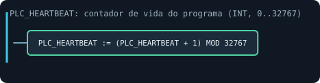

## Rede 01

Escalonamento: converte os valores brutos do módulo analógico (termopares, pressão, substrato) em °C / MPa.

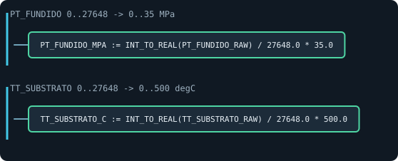

## Rede 02

Supervisão de temperatura: pré-alarme 390 °C, falha 400 °C e termopar rompido (só com termopar válido).

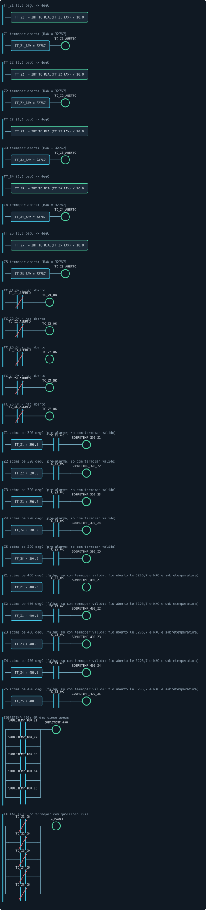

## Rede 03

Temporizadores de intertravamento: câmara quente 2 min, sem material 60 s, ventilador 10 s, K1 colado 1 s.

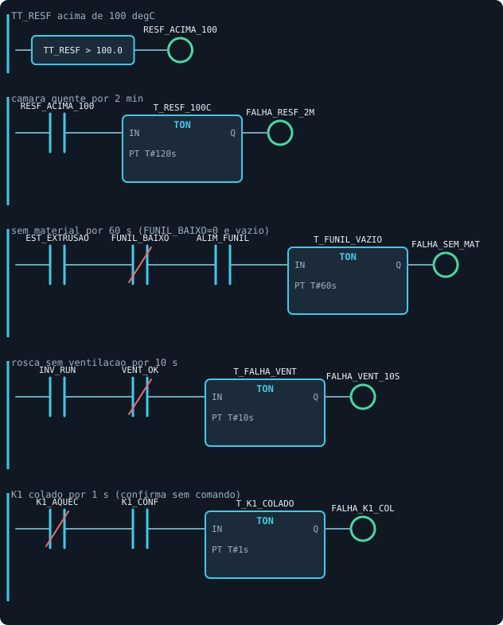

## Rede 04

Cérebro de segurança: `M_CAUSA` (10 causas), falha **travada**, reset condicionado e latches de **primeira causa**.

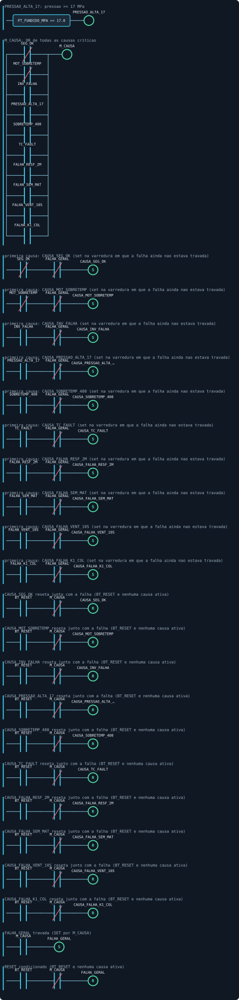

## Rede 05

Aquecimento: selo `EST_AQUEC` e contator `K1_AQUEC` (um escritor por saída).

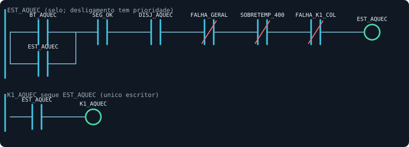

## Rede 06

PID das 5 zonas (`Util.PID`), executado **todo ciclo**; PWM por fase e porta do SSR (`SSR_Zn`).

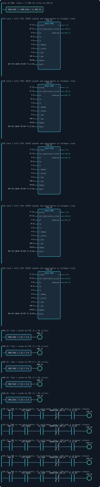

## Rede 07

Resfriamento da câmara por histerese: liga acima de 80 °C, mantém até 60 °C.

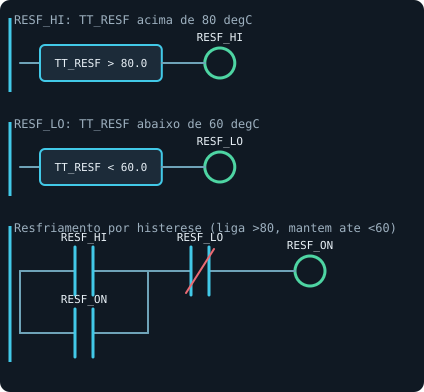

## Rede 08

Encharque de 15 min: todas as zonas ≥ 330 °C, contínuo; o TON zera se qualquer zona cair.

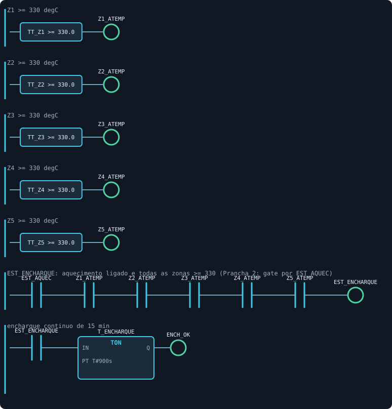

## Rede 09

PRONTO e permissivos do robô: encharque, secador, inversor, sem falha travada.

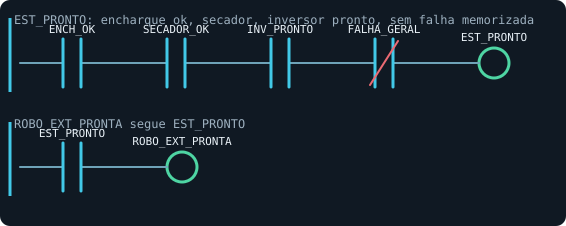

## Rede 10

Rosca: partida (`BT_LIGA`/robô), parada (`BT_DESLIGA` normalmente fechado) e `INV_RUN`.

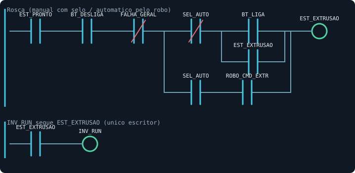

## Rede 11

Ventilação do motor: liga com a rosca e segue 5 min após parar.

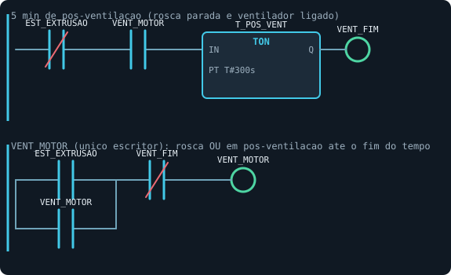

## Rede 12

Referência do inversor: política de pressão (≥ 16,5 MPa → ×0,9, piso 17 rpm), escala `INV_REF`.

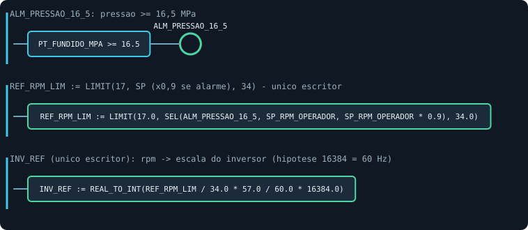

## Rede 13

PID do aquecedor infravermelho (IR) e porta do `SSR_IR` (habilitado só com robô em movimento).

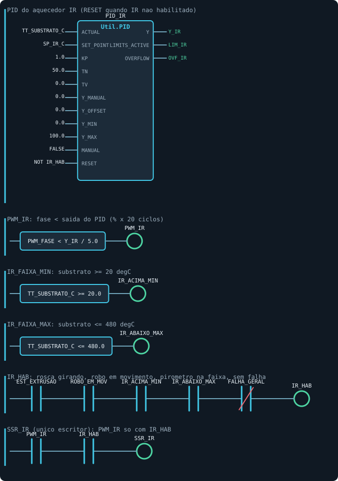

## Rede 14

Carregador do funil: `R_TRIG` + `CTU` contam os ciclos de recarga (lotes).

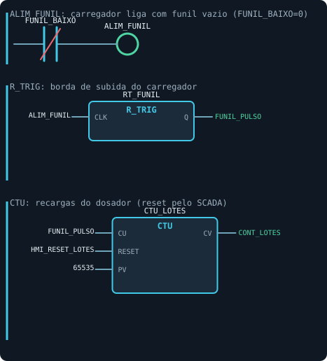

## Rede 15

Torre luminosa e sirene (verde/amarela/vermelha), alarme do trecho frio.

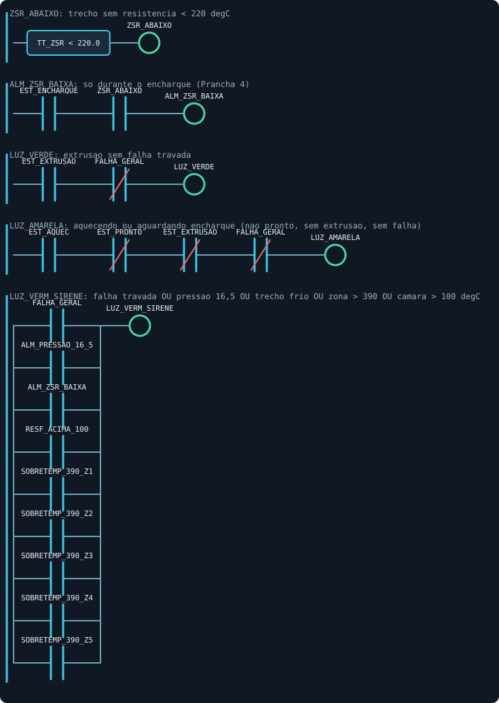
