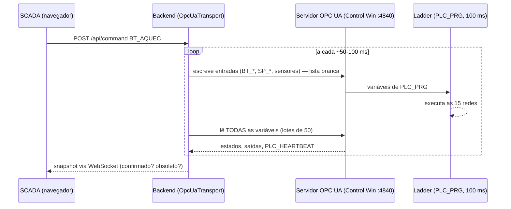

# Como o backend se liga ao CODESYS

Este documento explica **a ponte** entre o backend (Python/FastAPI) e o Ladder que roda no CODESYS Control Win: o que existe de cada lado, como as variáveis viajam, como a segurança funciona e **o que fazer quando dá erro** (todos os erros abaixo aconteceram de verdade durante o desenvolvimento).
Passo a passo de configuração no IDE: [MODO_PLC.md](MODO_PLC.md). Visão geral: [COMO_FUNCIONA.md](COMO_FUNCIONA.md).

## 1. A ideia
O CLP virtual **expõe** as variáveis do programa por um **servidor OPC UA** (padrão industrial). O backend é um **cliente OPC UA**: a cada ciclo escreve as entradas permitidas e lê o estado de volta. Nenhum outro canal liga os dois.

## 2. O que existe no lado do CODESYS
No projeto (`codesys/LFAM_Automacao_Ladder.project`), sob **Application**:

| Objeto | Para quê |
|---|---|
| **Gerenciador de comunicação → Servidor OPC UA** | Liga o servidor OPC UA do runtime (porta **4840**) |
| **Configuração de símbolos** | Escolhe **quais variáveis** de `PLC_PRG` ficam visíveis. Sem marcar `PLC_PRG`, o servidor não publica nada |
| **MainTask (100 ms)** | Executa `PLC_PRG` a cada 100 ms |

E, **no dispositivo** (não no projeto), em *Exibição → Tela de segurança → Dispositivos*: os **certificados** do *Servidor OPC UA* e de *Comunicação criptografada*. Sem eles o servidor só oferece canal **sem criptografia** e **recusa senha**. A autenticação usa o **usuário do dispositivo** (gerenciamento de usuários obrigatório do Control Win). O projeto não guarda senha.

## 3. O que existe no lado do backend (`backend/transport.py`)
`OpcUaTransport` (cliente `asyncua`):
1. **Conecta** com `Basic256Sha256 + SignAndEncrypt`, usuário/senha das variáveis de ambiente e um **certificado de cliente** local (`tools/gen_opcua_client_cert.py` → `work/pki/`, fora do Git).
2. **Resolve os nós:** procura `PLC_PRG` na árvore do servidor e mapeia as variáveis pelo **nome**. Se faltar alguma variável obrigatória: erro claro (“variáveis não publicadas na Symbol Configuration: …”).
3. **Escreve somente entradas** (`WRITABLE`): botões `BT_*`, setpoints `SP_*`/`SP_RPM_OPERADOR`, sinais de sensor/estado externos (`*_RAW`, `SEG_OK`, `VENT_OK`, `K1_CONF`, `INV_*`…). **Nunca** escreve saídas do programa (`K1_AQUEC`, `SSR_*`, `INV_RUN`, `FALHA_GERAL`…).
4. **Lê tudo** de volta (em lotes de 50 — o servidor recusa pedidos grandes).
5. **Tipos:** `BOOL`→Boolean, `INT`→Int16, `WORD`→UInt16, `REAL`→Float. Blocos (`TON`, `Util.PID`, `CTU`…) não são mapeados.
6. **Heartbeat:** `PLC_HEARTBEAT` deve mudar a cada ciclo. Se ficar **2 s** parado, o dado é **obsoleto**: a API marca `plc_connected=false`, a tela mostra **SEM COMUNICAÇÃO** e comandos são recusados.
7. **Botões são pulsos:** `BT_AQUEC`/`BT_LIGA`/`BT_RESET` ficam 0,5 s em 1; `STOP` abre o contato `BT_DESLIGA` (normalmente fechado) por 1 s. Se a conexão cair, os pulsos pendentes são **descartados** — nunca reenviados sozinhos.
8. **Reconexão** automática com espera de 3 s entre tentativas.

## 4. Quem fornece os sinais de sensor?
No modo PLC, **a planta continua simulada**: o backend roda `simulator/lfam_sim.py`, calcula temperaturas/pressão/rpm a partir das saídas lidas (K1, SSR, INV_RUN…) e **escreve** os sinais resultantes como entradas do CLP. O tempo da planta segue o relógio real (os temporizadores do CLP também). Com máquina real, essas entradas viriam do hardware e o backend deixaria de escrevê-las.

## 5. Segurança (o que protege a ponte)
- Canal **assinado e criptografado**; sem canal seguro o servidor nem aceita senha.
- Credenciais **só em variáveis de ambiente** da sessão (`tools/start-plc.ps1` pede a senha de forma oculta). Nada de senha em arquivo, log ou Git.
- Logs do `asyncua` forçados a `WARNING` (em `DEBUG` ele imprimia a senha — achado de segurança, com teste).
- Lista branca de escrita e validação de faixa (setpoints 330–375 °C, 17–34 rpm).
- A tela **não** é parada de emergência; a emergência é hardware independente.

## 6. Erros comuns e como resolver
| Sintoma | Causa | Solução |
|---|---|---|
| IDE: “Nenhum dispositivo está respondendo” | Serviço **CODESYS Control Win** parado | Ícone da bandeja → *Start PLC*, ou `Start-Service "CODESYS Control Win V3 - x64"` (admin); depois *Escanear rede* |
| `BadIdentityTokenInvalid` **com** “Sending plain-text password” | Sem certificados no dispositivo → só canal sem criptografia | Gerar os certificados na Tela de segurança e usar `LFAM_OPCUA_SECURITY="Basic256Sha256,SignAndEncrypt"` |
| `BadIdentityTokenInvalid` **com canal seguro** | Usuário ou senha errados | Conferir `LFAM_OPCUA_USER`/senha (teste em *Online → Logon* no IDE). Não insista: muitas tentativas podem bloquear o usuário |
| `programa PLC_PRG não encontrado` | Símbolos não publicados | Marcar `PLC_PRG` em *Configuração de símbolos*, compilar e **enviar ao CLP** (Logon/Download) |
| `BadTooManyOperations` | Pedido com variáveis demais | Já tratado (lotes de 50) — atualize o backend |
| `TimeoutError` | Timeout curto na 1ª conexão | `LFAM_OPCUA_TIMEOUT` (padrão 10 s) |
| `BadNodeIdUnknown` | A aplicação foi **parada/recarregada** no CLP | Garanta *Online → Iniciar* e **reinicie o backend** |
| `plc_connected=false` sem erro | Aplicação **parada** (heartbeat não muda) | *Online → Iniciar* |
| Falha logo na partida (`FALHA_TRAVADA`) | O Ladder inicia com entradas em 0 (= segurança em falha) e trava antes de receber os valores reais | **Normal**: aperte *Reset de falha* (o script de ensaio já faz isso) |

`/api/health` mostra `link_error` com a causa exata.

## 7. Como o programa chega ao CLP (resumo)
`python tools/gen_ld_xml.py` → `codesys/exports/LFAM_PROGRAM.xml` → `tools/codesys_scripts/build_program.py` (importa no projeto, adiciona a biblioteca Util, define `MainTask` = 100 ms, compila) → no IDE: *Logon → Download → Iniciar*. Detalhes: [INSTALLATION_COMPLETE.md](INSTALLATION_COMPLETE.md).
