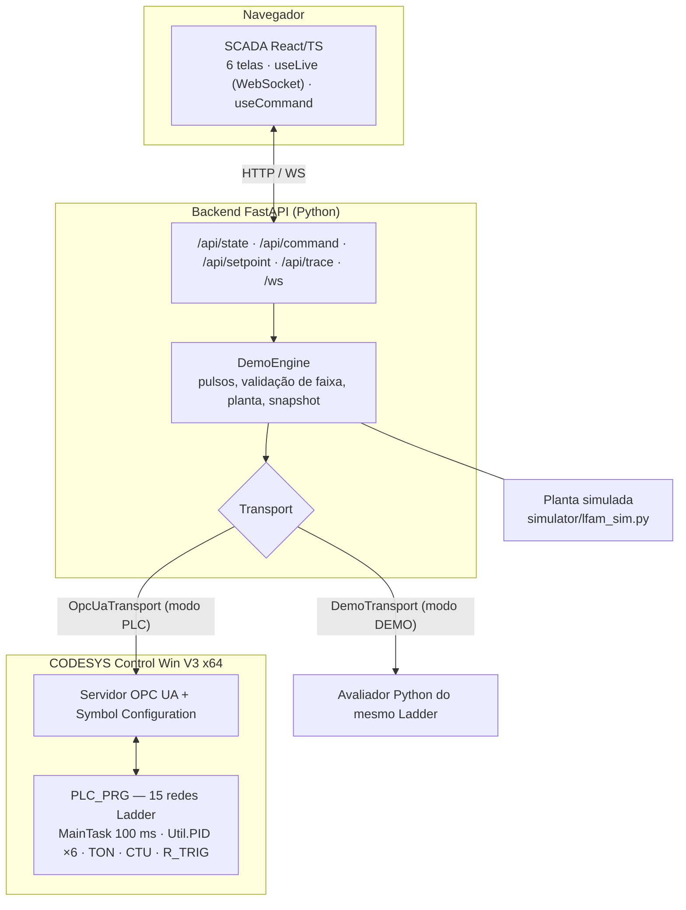

# Arquitetura (como construída) — extrusora LFAM

> Visão leiga e passo a passo: [COMO_FUNCIONA.md](COMO_FUNCIONA.md). Aqui está a visão técnica.

## Camadas e responsabilidades

- **Ladder (fonte da verdade):** estados, permissivos, PID, temporizadores, falhas travadas e reset condicionado. Gerado por `codesys/generator` → `codesys/exports/LFAM_PROGRAM.xml` → importado no CODESYS (Scripting API) → compilado → baixado no Control Win.
- **Backend:** traduz pedidos da tela em escritas **somente em entradas** da lista branca (`WRITABLE` em `backend/transport.py`), lê as variáveis de volta, calcula a obsolescência pelo heartbeat (`PLC_HEARTBEAT`, limite 2 s) e **descarta pulsos pendentes** na perda de enlace. Em modo PLC o tempo da planta segue o relógio real (os TON do CLP também).
- **Transportes:** `DemoTransport` (avaliador Python, rotulado DEMO) e `OpcUaTransport` (asyncua, `Basic256Sha256` + `SignAndEncrypt`, usuário/senha só em variáveis de ambiente, leituras em lotes de 50, loggers do asyncua em WARNING para não vazar a senha).
- **SCADA:** nunca escreve estado; mostra o que o backend leu. Botões têm fases `idle → pendente → confirmado/negado`, e o "confirmado" só aparece quando o estado volta do CLP.
- **Planta simulada:** temperaturas (1ª ordem + acoplamento), pressão, rotação, falhas injetáveis. Não decide permissivos. Parâmetros hipotéticos.

## Contrato de dados
`docs/projeto/tags.csv` (164 variáveis do programa gerado): nome, tipo IEC, unidade, sentido de escrita, origem e status. Variáveis de **entrada** (botões, setpoints, sensores simulados) são escritas pelo backend; **saídas e estados** são só leitura.

## Decisões de projeto que importam
- **PID sem contatos antes:** os 5 PIDs e o do IR rodam **todo ciclo**; o bloqueio é no pino `RESET` e no portão do SSR (evita saída "congelada" mantendo aquecedor ligado).
- **Um escritor por saída** (verificado por teste).
- **Falha travada com reset condicionado:** `M_CAUSA` = OR das 10 causas críticas; `FALHA_GERAL` é *set*; reset = `BT_RESET AND NOT M_CAUSA`; latches `CAUSA_*` preservam a **primeira causa**.
- **Política de pressão (D5):** ≥ 16,5 MPa → referência ×0,9 (piso 17 rpm); ≥ 17 MPa → falha travada.
- **Presets de TON como `inVariable`:** o importador do CODESYS perde o literal dentro do pino PT (preset 0); há teste de regressão no XML.
- **Termopar inválido** (leitura 3276,7 °C) não é tratado como sobretemperatura; gera `TC_FAULT`.

## O que esta arquitetura NÃO é
Não é segurança certificada: a emergência é hardware independente. Não é validação de máquina real: ganhos de PID, escala do inversor (`INV_REF`, 16384 = 60 Hz) e parâmetros da planta são hipóteses. Endereços Siemens (`%I/%Q/%IW`) aparecem apenas em `tags.csv` (coluna acadêmica); o programa usa variáveis simbólicas.

## Riscos conhecidos e tratamento
Ver [SOURCE_RECONCILIATION.md](../academico/SOURCE_RECONCILIATION.md) (D1–D25) e [AUDIT_TESTS_AND_GENERATOR.md](../projeto/AUDIT_TESTS_AND_GENERATOR.md).
