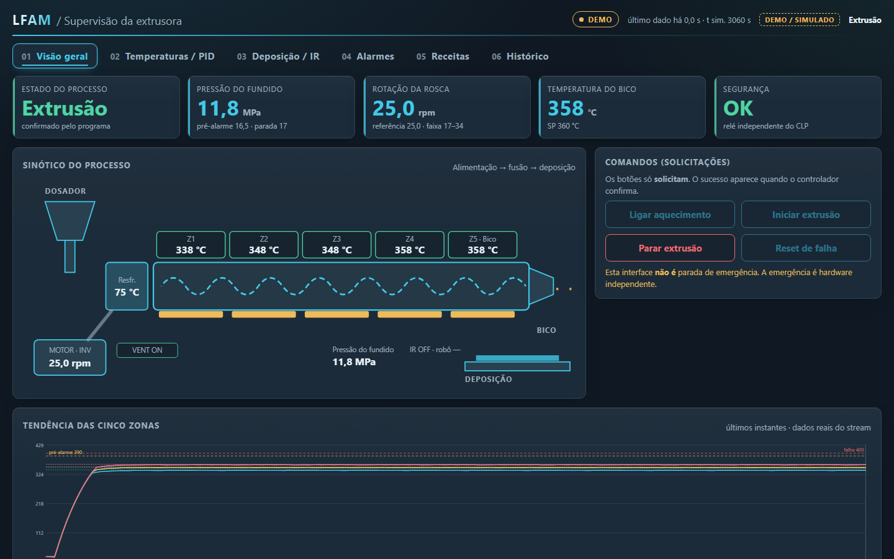
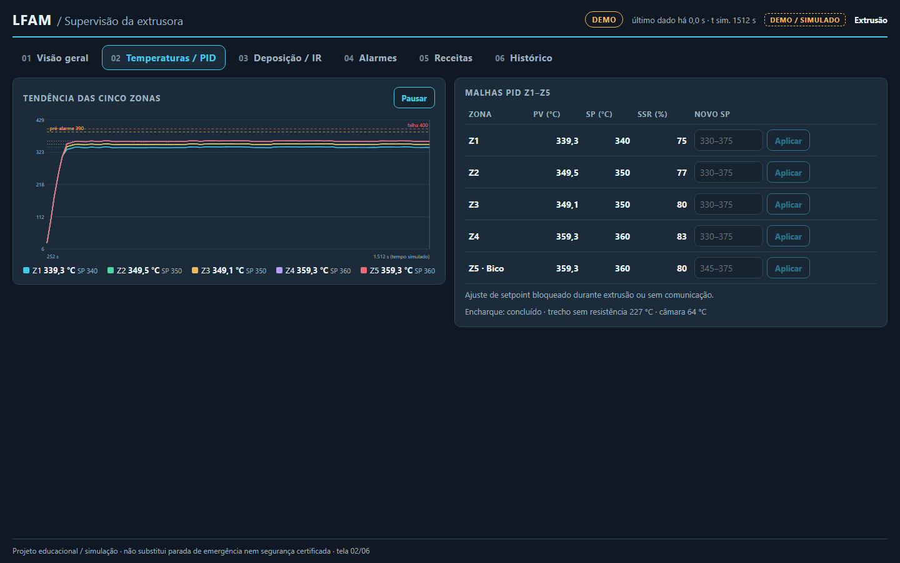
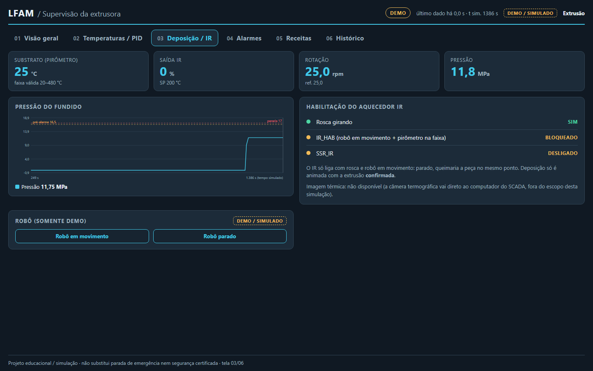
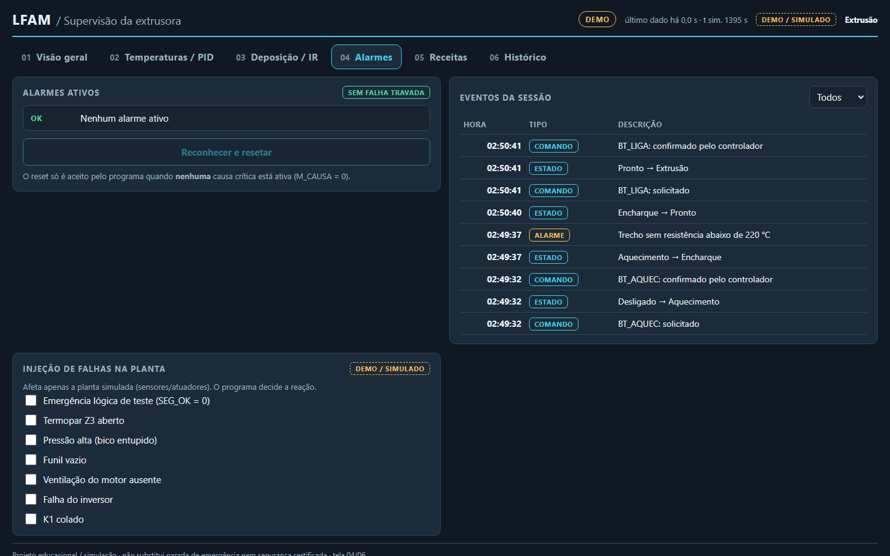
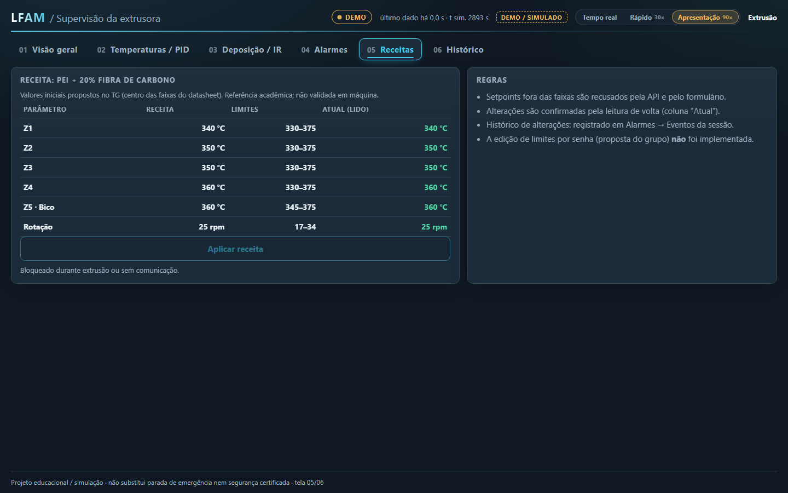
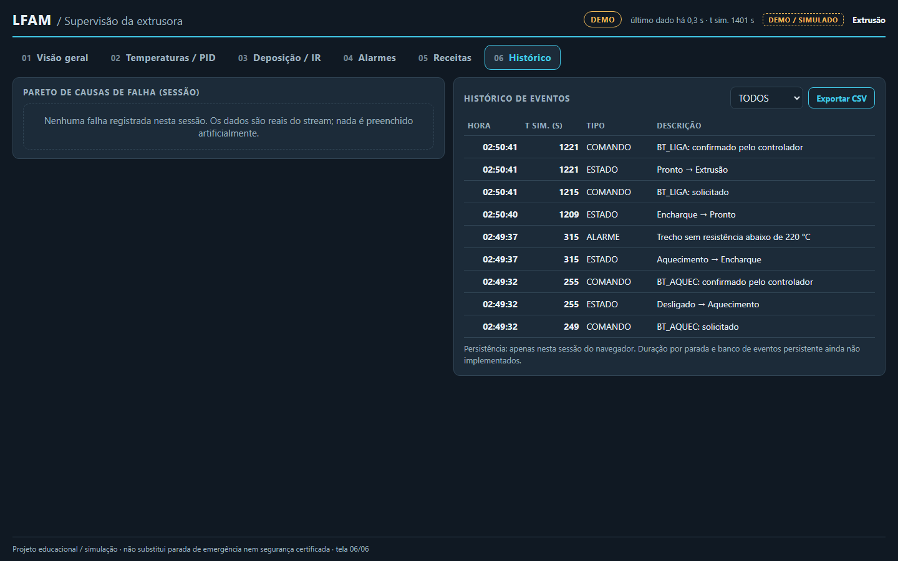
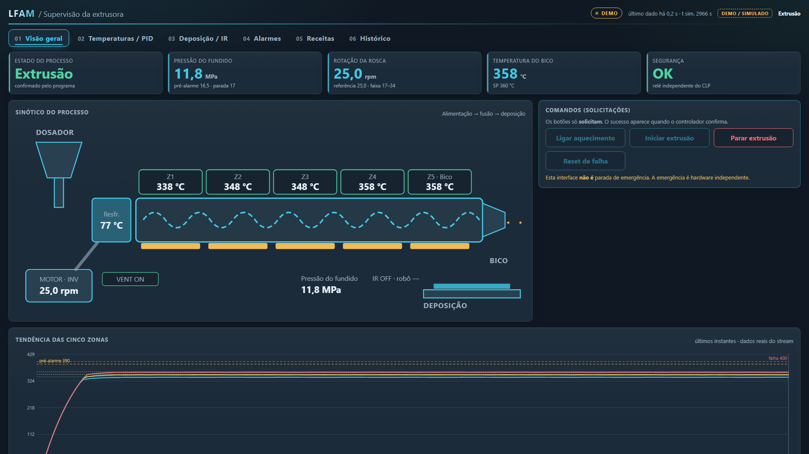
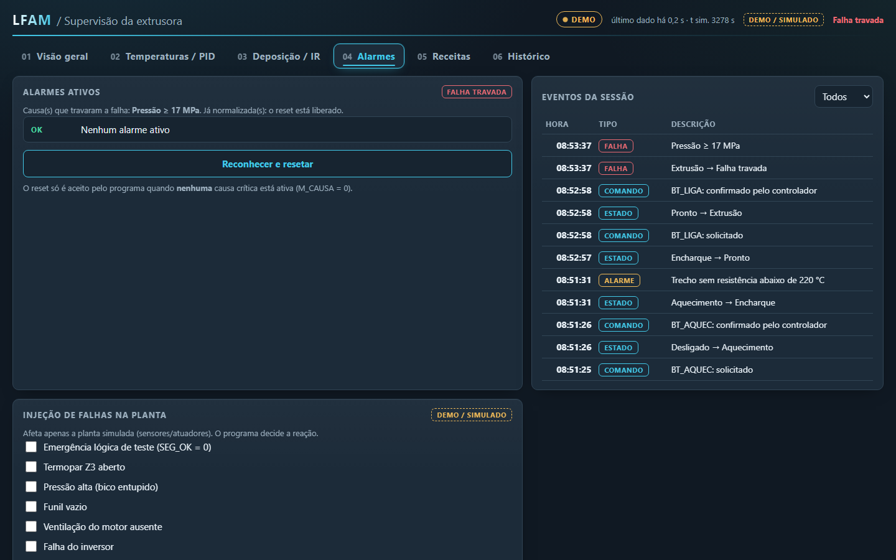
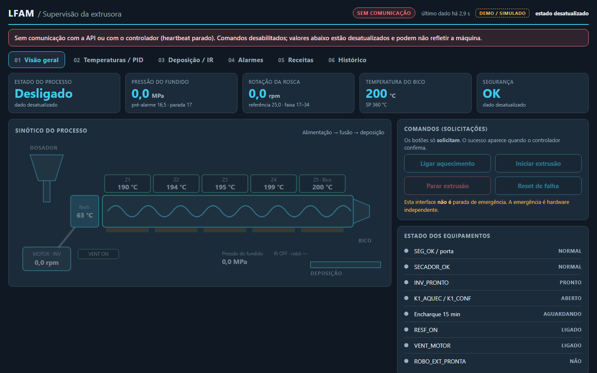
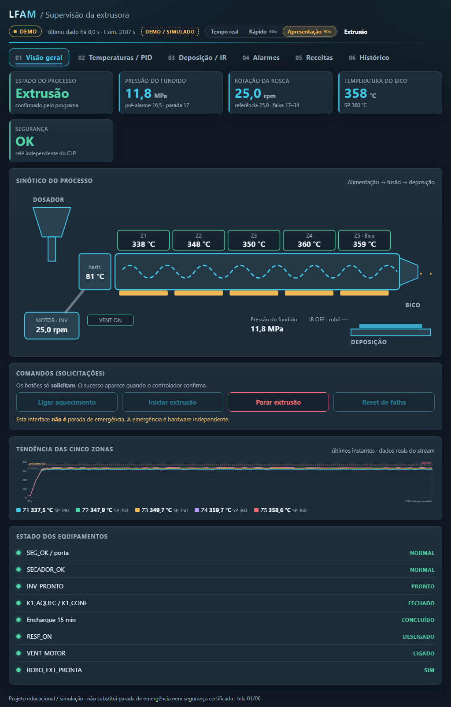

# Galeria do SCADA

Todas as imagens são **capturas reais da interface** em modo **DEMO / SIMULADO** (planta simulada). O mesmo visual aparece no modo CLP, com o selo `LÓGICA NO CLP · PLANTA SIMULADA`. Como rodar: [INICIO_RAPIDO](../guias/INICIO_RAPIDO.md).

## Animações
<table>
<tr>
<td align="center" width="50%"> <b>Fluxo completo</b> aquecer → encharque → pronto → extrusão → falha de pressão → reset (relógio acelerado)</td>
<td align="center" width="50%"> <b>Tour das 6 telas</b> ajuste de setpoint, deposição, receitas, tendência, alarme e histórico</td>
</tr>
<tr>
<td align="center" colspan="2"> <b>No celular</b> (390 px): mesmo fluxo, layout responsivo</td>
</tr>
</table>

## As 6 telas
| | Tela | O que o operador faz aqui |
|---|---|---|
|  | **01 · Visão geral** | Vê estado, pressão, rotação, temperatura do bico e segurança; **solicita** aquecimento, extrusão, parada e reset. O sinótico mostra a rosca girando e as zonas. O botão só vira *✓ Confirmado* quando o CLP confirma |
|  | **02 · Temperaturas / PID** | Tendência das 5 zonas com limites de 390/400 °C, PV × SP × saída do SSR de cada malha e ajuste de setpoint (bloqueado durante a extrusão) |
|  | **03 · Deposição / IR** | Pressão do fundido, rotação, aquecedor infravermelho e prontidão do robô |
|  | **04 · Alarmes** | Alarmes ativos, **causa que travou a falha**, reset condicionado (só depois que a causa some) e injeção de falhas de teste (DEMO) |
|  | **05 · Receitas** | Conjuntos de setpoints validados contra as faixas permitidas |
|  | **06 · Histórico** | Eventos e comandos, com exportação em CSV |

## Estados que importam
| | |
|---|---|
|  **Operação normal** (1920×1080) |  **Falha travada** com a causa registrada |
|  **Sem comunicação**: valores sem cor, comandos desabilitados |  **Tablet** (1024×768) |

Também há capturas das 6 telas em 1920×1080, 1440×900, 1024×768 e 390×844 em [`evidence/scada/`](../evidence/scada).

## E o Ladder?
As 15 redes estão em imagens em [LADDER.md](LADDER.md), com a explicação de cada etapa em [LADDER_EXPLICADO.md](LADDER_EXPLICADO.md).
