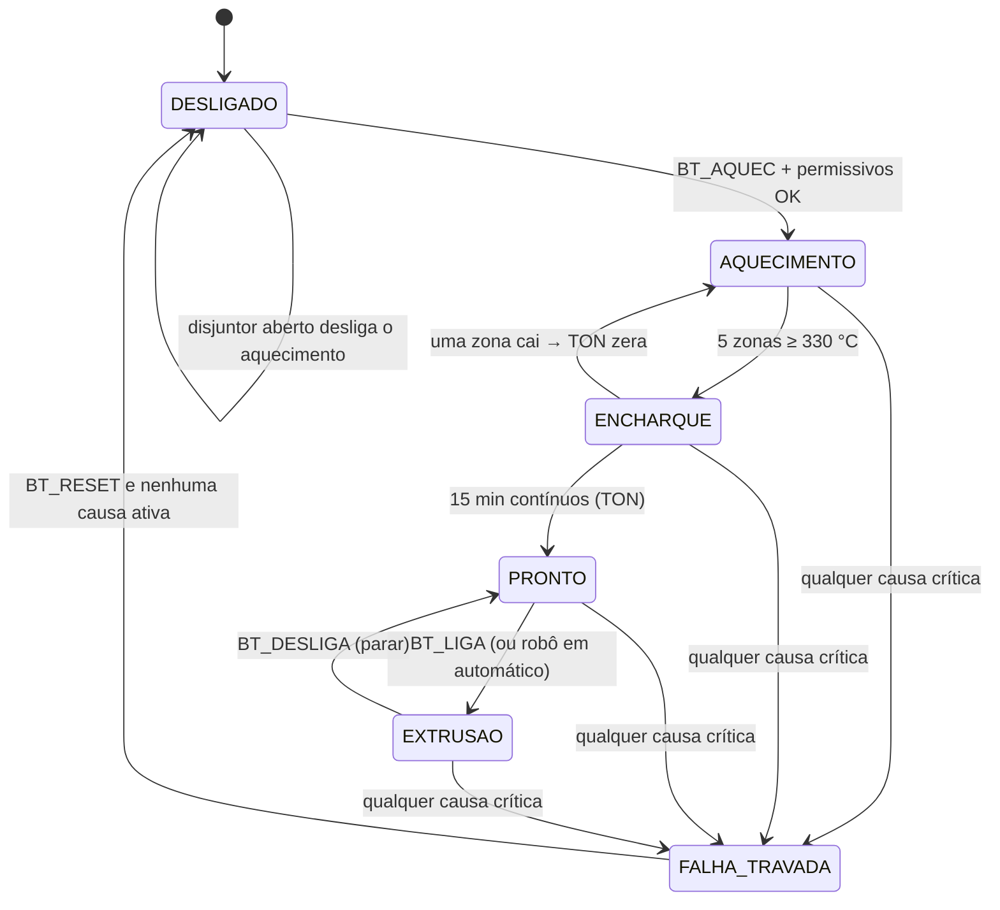

# O Ladder explicado: o que cada etapa faz

Complementa o [catálogo de imagens](LADDER.md). Aqui está o **porquê** de cada parte. Se você nunca viu Ladder, comece pela seção 1.

## 1. Como ler uma rede Ladder (3 minutos)
Ladder é um circuito de relés desenhado em software. A energia "flui" da esquerda para a direita; se houver um caminho fechado, a **saída (bobina)** liga.

- **Contato `| |`** = "esta variável está ligada?" (leitura). **Contato com `/`** (negado) = "está *desligada*?".
- **Em série** (um depois do outro) = **E**: todos precisam estar fechados.
- **Em paralelo** (ramos empilhados) = **OU**: basta um.
- **Bobina `( )`** = escreve a variável. `(S)` liga e **mantém** (*set*); `(R)` desliga (*reset*).
- **Blocos** (TON, PID, CTU…) são "caixas" com entradas e saídas.

Exemplo real, rede **04c** (reset da falha): `BT_RESET` **E** `M_CAUSA` negado → `(R) FALHA_GERAL`.
Em português: *"o botão de reset só apaga a falha se não houver nenhuma causa crítica ativa"*.

## 2. O ciclo de varredura
O CLP repete tudo, **de cima para baixo**, a cada **100 ms** (tarefa `MainTask`). A **ordem** importa:

| Ordem | Etapa | Redes | O que faz |
|---|---|---|---|
| 1 | Vida | 00 | `PLC_HEARTBEAT` conta +1 por ciclo (a tela usa para saber se o CLP está vivo) |
| 2 | Escalonamento | 01–02 | Converte sinais brutos em °C / MPa e detecta termopar aberto |
| 3 | PIDs e PWM | 06 | 5 PIDs de zona + PID do IR calculam a potência (%) e o PWM por fase |
| 4 | Supervisão | 02–03 | Sobretemperatura, termopar, temporizadores de intertravamento |
| 5 | **Segurança** | 04 | Junta as causas, trava a falha, preserva a primeira causa, reset condicionado |
| 6 | Sequência | 05, 07–11 | Aquecimento, resfriamento, encharque, pronto, rosca, ventilação |
| 7 | Saídas | 06, 12–15 | Referência do inversor, portas dos SSR, IR, carregador, torre luminosa |

Cada saída é escrita **por uma única rede** (sem "briga" entre redes) — há teste automático para isso.

## 3. A sequência do processo (máquina de estados)

*Permissivos do aquecimento (rede 05):* `SEG_OK`, `DISJ_AQUEC`, sem `FALHA_GERAL`, sem `SOBRETEMP_400`, sem `FALHA_K1_COL`. O estado `FALHA_TRAVADA` não é uma variável: a tela o deduz de `FALHA_GERAL`.

## 4. Rede por rede

| Rede | Função | Entradas principais | Saídas | Por que existe / cuidado |
|---|---|---|---|---|
| **00** | Heartbeat | — | `PLC_HEARTBEAT` | Permite detectar CLP parado sem depender de rede |
| **01** | Escalonamento | `PT_FUNDIDO_RAW`, `TT_SUBSTRATO_RAW` | `PT_FUNDIDO_MPA`, `TT_SUBSTRATO_C` | 0–27648 → 0–35 MPa / 0–500 °C |
| **02** | Termopares e sobretemperatura | `TT_Zn_RAW` | `TT_Zn`, `TC_Zn_ABERTO/OK`, `SOBRETEMP_390/400_Zn`, `TC_FAULT`, `SOBRETEMP_400` | 390 °C = aviso, 400 °C = falha. **Só vale com termopar válido** (fio aberto lê 3276,7 °C e não é sobretemperatura) |
| **03** | Temporizadores de intertravamento | `TT_RESF`, `FUNIL_BAIXO`, `INV_RUN`, `VENT_OK`, `K1_CONF` | `FALHA_RESF_2M`, `FALHA_SEM_MAT`, `FALHA_VENT_10S`, `FALHA_K1_COL` | Câmara > 100 °C por 2 min; sem material 60 s; rosca sem ventilador 10 s; K1 colado 1 s |
| **04** | **Segurança** | as 10 causas | `M_CAUSA`, `FALHA_GERAL`, `CAUSA_*` | `FALHA_GERAL` é *set* (trava). Reset = `BT_RESET` **E NÃO** `M_CAUSA`. Os latches `CAUSA_*` guardam a **primeira causa**, mesmo que ela suma depois |
| **05** | Aquecimento | `BT_AQUEC`, permissivos | `EST_AQUEC`, `K1_AQUEC` | Selo; qualquer permissivo perdido desliga (prioridade de desligamento) |
| **06** | PID, PWM e SSR | `TT_Zn`, `SP_Zn`, `EST_AQUEC`, `K1_CONF` | `Y_Zn`, `PWM_Zn`, `SSR_Zn` | **O PID não fica atrás de contatos** (rodaria "congelado"): roda todo ciclo; o bloqueio é no pino `RESET` e no portão do SSR |
| **07** | Resfriamento | `TT_RESF` | `RESF_ON` | Histerese: liga > 80 °C, mantém até < 60 °C |
| **08** | Encharque | `TT_Zn` | `EST_ENCHARQUE`, `ENCH_OK` | 5 zonas ≥ 330 °C **contínuas** por 900 s; se uma cair, o TON zera |
| **09** | Pronto | `ENCH_OK`, `SECADOR_OK`, `INV_PRONTO` | `EST_PRONTO`, `ROBO_EXT_PRONTA` | Sem falha travada; avisa o robô |
| **10** | Rosca | `EST_PRONTO`, `BT_LIGA`, `BT_DESLIGA`, `SEL_AUTO`, `ROBO_CMD_EXTR` | `EST_EXTRUSAO`, `INV_RUN` | `BT_DESLIGA` é **normalmente fechado** (0 = parar): se o fio romper, para. Manual com selo ou automático pelo robô |
| **11** | Ventilação do motor | `EST_EXTRUSAO` | `VENT_MOTOR` | Liga com a rosca e segue **5 min** após parar |
| **12** | Pressão e velocidade | `PT_FUNDIDO_MPA`, `SP_RPM_OPERADOR` | `ALM_PRESSAO_16_5`, `PRESSAO_ALTA_17`, `REF_RPM_LIM`, `INV_REF` | ≥ 16,5 MPa: referência × 0,9 (piso 17 rpm); ≥ 17 MPa: falha travada |
| **13** | Infravermelho (IR) | `EST_EXTRUSAO`, `ROBO_EM_MOV`, `TT_SUBSTRATO_C` | `IR_HAB`, `SSR_IR` | Só aquece com rosca girando, robô em movimento e pirômetro na faixa |
| **14** | Carregador/lotes | `FUNIL_BAIXO` | `ALIM_FUNIL`, `CONT_LOTES` | `R_TRIG` + `CTU`: conta cada recarga; reset pela tela |
| **15** | Torre luminosa | estados e alarmes | `LUZ_VERDE`, `LUZ_AMARELA`, `LUZ_VERM_SIRENE` | Verde = extrudando sem falha; amarela = aquecendo; vermelha/sirene = falha ou aviso |

## 5. As 10 causas de falha (rede 04)
`SEG_OK = 0` (segurança/porta), `MOT_SOBRETEMP = 0`, `INV_FALHA`, `PRESSAO_ALTA_17`, `SOBRETEMP_400`, `TC_FAULT`, `FALHA_RESF_2M`, `FALHA_SEM_MAT`, `FALHA_VENT_10S`, `FALHA_K1_COL`.
**Efeito comum:** `FALHA_GERAL` trava → aquecimento e rosca desligam, sirene liga. **Reset:** só com `BT_RESET` **depois** que nenhuma causa estiver ativa.
**Aviso × falha:** aviso (390 °C, 16,5 MPa, trecho frio) sinaliza sem travar; falha trava.

## 6. Quem escreve o quê (importante para a ligação com o backend)
- **Entradas** (o mundo externo escreve; o Ladder só lê): botões `BT_*`, setpoints `SP_*`, sinais dos sensores `*_RAW`, `SEG_OK`, `VENT_OK`, `K1_CONF`, `INV_*`… No modo PLC, **o backend escreve estas** (as de sensor vêm da planta simulada).
- **Saídas e estados** (o Ladder escreve; o resto só lê): `K1_AQUEC`, `SSR_*`, `INV_RUN`, `INV_REF`, `EST_*`, `FALHA_GERAL`, `CAUSA_*`, luzes. O backend **nunca** escreve nelas.
- Lista completa com tipo e sentido: [tags.csv](../projeto/tags.csv).

## 7. Como isso foi verificado
- **Lógica (avaliador Python do mesmo modelo):** testes por rede em `tests/` (limiares, temporizadores, selo, reset com cada causa, PWM, anti-windup).
- **No CLP real (Control Win):** [CP3](../evidence/CP3_ROUNDTRIP_OK.txt) e [CP4 cenários](../evidence/CP4_ONLINE_SCENARIOS.txt). Esse ensaio achou defeitos que o avaliador não via (presets de TON zerados na importação) — por isso os dois níveis de teste existem.
- **PID:** o `Util.PID` real foi comparado com o modelo: [CP4_PID_COMPARE](../evidence/CP4_PID_COMPARE.txt). Os ganhos (KP 8 %/°C, TN 20 s nas zonas) são **hipotéticos**, ainda sem sintonia numa máquina real.

## 8. Como o Ladder foi criado
O CODESYS não é "desenhado por IA": um gerador em Python (`codesys/generator`) descreve as redes (contatos, séries, paralelos, blocos) e produz **PLCopen XML**, que o CODESYS importa e compila (`tools/codesys_scripts/build_program.py`). O mesmo modelo alimenta o avaliador de testes e os desenhos de [LADDER.md](LADDER.md) (`tools/render_ladder.py`).
